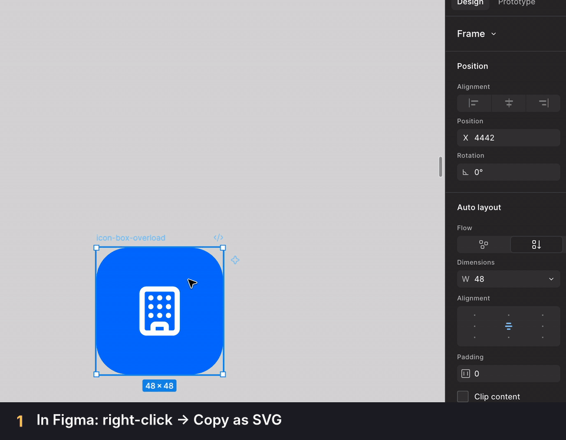

# svgV: SVG to JSX

Paste SVG from Figma and other design tools straight into React as clean JSX. No more fixing `stroke-width`, `class` and `style` by hand.



## Features

- **Paste and it's JSX.** Copy an SVG, paste it into a `.tsx` or `.jsx` file, and it arrives as valid JSX.
- **Paste as a component.** One command turns the SVG into a typed React component, with `{...props}` on the root `<svg>` and the `SVGProps` import added for you.
- **Never in your way.** Ordinary text, code, HTML and JSX paste exactly as before. Only pure SVG is converted.
- **Changed your mind?** Press `Cmd+.` (`Ctrl+.` on Windows and Linux) right after pasting to switch to the original SVG, or to the component version.
- **Private.** Everything runs locally. Nothing is sent over the network.

## Usage

1. In Figma, right-click a layer and choose **Copy/Paste as → Copy as SVG**. Any other SVG source works too.
2. Paste into a `.tsx` or `.jsx` file.

**Before**

```xml
<svg width="24" height="24" viewBox="0 0 24 24" fill="none" xmlns="http://www.w3.org/2000/svg">
<path d="M5 12H19M19 12L13 6" stroke="#1E1E1E" stroke-width="2" stroke-linecap="round" style="opacity:0.5"/>
</svg>
```

**After**

```tsx
<svg
  width="24"
  height="24"
  viewBox="0 0 24 24"
  fill="none"
  xmlns="http://www.w3.org/2000/svg"
>
  <path
    d="M5 12H19M19 12L13 6"
    stroke="#1E1E1E"
    strokeWidth="2"
    strokeLinecap="round"
    style={{ opacity: 0.5 }}
  />
</svg>
```

### Paste as a component

Run **svgV: Paste as Component** from the Command Palette, pick a name, and get:

```tsx
import type { SVGProps } from "react";

export function ArrowIcon(props: SVGProps<SVGSVGElement>) {
  return (
    <svg viewBox="0 0 24 24" fill="none" {...props}>
      {/* ... */}
    </svg>
  );
}
```

Because `{...props}` comes last, `<ArrowIcon width={32} className="text-red-500" />` overrides the SVG's own values.

## Commands

| Command                      | What it does                                                                            |
| ---------------------------- | --------------------------------------------------------------------------------------- |
| **svgV: Paste as JSX**       | Converts the SVG on the clipboard to inline JSX, even when automatic conversion is off. |
| **svgV: Paste as Component** | Converts the SVG on the clipboard to a named React component.                           |

## Settings

| Setting                  | Default  | Description                                                                |
| ------------------------ | -------- | -------------------------------------------------------------------------- |
| `svg-v.autoPasteEnabled` | `true`   | Convert SVG automatically on paste.                                        |
| `svg-v.outputFormat`     | `inline` | What a normal paste inserts: `inline` JSX or a `component`.                |
| `svg-v.language`         | `infer`  | Typed components in `.tsx` files (`infer`), always (`ts`) or never (`js`). |
| `svg-v.componentNaming`  | `prompt` | Ask for a component name (`prompt`) or use the suggested one (`infer`).    |
| `svg-v.includeJsFiles`   | `false`  | Also convert in `.js` files, for projects that allow JSX there.            |

## What gets converted

| SVG                                | JSX                        |
| ---------------------------------- | -------------------------- |
| `class`, `for`                     | `className`, `htmlFor`     |
| `stroke-width`, `xlink:href`       | `strokeWidth`, `xlinkHref` |
| `style="opacity:0.5"`              | `style={{ opacity: 0.5 }}` |
| `<path></path>`                    | `<path />`                 |
| `<?xml ?>`, `<!DOCTYPE>`, comments | removed                    |
| `data-*`, `aria-*`                 | kept as they are           |

## Known limitations

- **IDs are kept as they are.** Figma IDs like `clip0_12_34` are not renamed, so rendering the same component twice on one page gives duplicate IDs. This can matter for clip paths, masks and gradients. Automatic unique IDs are planned.
- **`.ts` files are not supported**, because they can't contain JSX. `.js` files are supported when `svg-v.includeJsFiles` is on.
- **Paste as Component works with one SVG at a time.** Several SVGs pasted together are wrapped in a fragment (`<>…</>`) as inline JSX.
- **SVGs over 200 KB are pasted unchanged**, to keep pasting fast.

## Requirements

VS Code 1.97 or newer.

## Feedback

Found an SVG that doesn't convert well? Please [open an issue](https://github.com/TOLU-MICH/SVGV/issues) and include the SVG.
